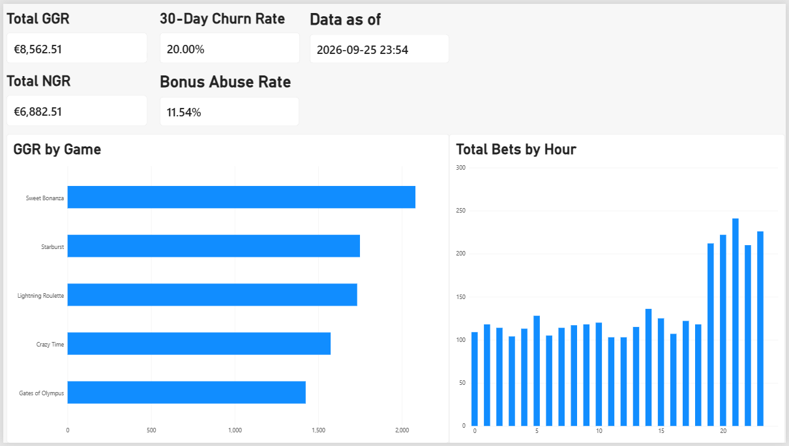

# iGaming SQL Analytics

## Situation
Online casino operations generate large volumes of betting data that need to be structured and analyzed to answer real business questions: how much revenue the house generates, which games perform best, how many players stop playing over time, and whether bonus offers are being exploited by players who claim them and leave.

## Task
Design and populate a relational database simulating a casino operation, extract the core metrics used across the iGaming sector — GGR (Gross Gaming Revenue), NGR (Net Gaming Revenue), player churn and bonus abuse rate — with SQL, and present them in a Power BI dashboard.

## Action
- Modeled a 6-table relational schema (`players`, `providers`, `games`, `bets`, `bonuses`, `player_bonuses`) with primary/foreign keys and normalization applied throughout — see `schema.sql`.
- Generated 90 days of synthetic betting history (2,000 bets across 50 players) using PostgreSQL's `generate_series` and CTEs, with `payout` calculated as a randomized fraction of `bet_amount` to approximate a realistic house edge — see `seed.sql`.
- Identified and corrected a data generation gap: the original dataset simulated only continuously active players, making churn always equal to 0%. Fixed by deliberately shifting a subset of players' bet history, producing a realistic churn rate.
- Refined the dataset with realistic time-based patterns: 500 additional bets concentrated in nighttime peak hours, and 800 bets simulating a single high-volume event day — bringing the total to 3,300 bets.
- Extended the schema to link each bet to the bonus that funded it, through a nullable foreign key added with `ALTER TABLE`. Linking the data exposed bonuses marked as redeemed after the player's last bet; these were corrected with a rule-based update instead of hard-coded IDs.
- Designed a bonus abuse scenario (players who claim a bonus, bet once and leave) and defined a metric for it: a bonus counts as abused when the player places no other bet within 7 days, excluding bets whose 7-day window has not closed yet.
- Wrote and validated five analytical queries — total GGR, GGR by game, NGR, 30-day churn and bonus abuse rate — all measured against a fixed reference date (the most recent bet), so results do not drift over time — see `queries.sql`.
- Built a Power BI dashboard connected to the PostgreSQL database, with DAX measures validated against the SQL results — see `igaming-sql-analytics-dashboard.pbix`.
- Documented every non-obvious design decision and its reasoning in `DECISIONS.md`, including the known limitations of the dataset.

## Result
- **Total GGR:** €8,562.51 (on €337,475.80 wagered across 3,300 bets)
- **NGR:** €6,882.51 (after €1,680.00 in redeemed bonuses; unused bonuses cost the operator nothing)
- **Top-performing game by GGR:** Sweet Bonanza (€2,081.37)
- **30-day churn rate:** 20.00% (10 of 50 players)
- **Bonus abuse rate:** 11.54% (6 of 52 eligible bonuses): the 5 designed cases plus 1 false positive, a player who paused for just over 7 days, a known boundary effect of a fixed time window
- **Peak activity window:** 33.7% of all bets were placed between 7 PM and midnight, about 21% of the day

## Dashboard

## Tech Stack
PostgreSQL, SQL (DDL, DML, DQL, joins, subqueries, CTEs, `NOT EXISTS`, filtered aggregates), Power BI (DAX), Git/GitHub.

## Project Structure
- `schema.sql` — database schema (DDL)
- `seed.sql` — synthetic data generation (regenerates an equivalent dataset on each run)
- `queries.sql` — core metric queries
- `DECISIONS.md` — architecture decisions and reasoning
- `igaming-sql-analytics-dashboard.pbix` — Power BI dashboard
- `dashboard.png` — dashboard preview

## How to Run
1. Create an empty PostgreSQL database (e.g. `igaming_casino`).
2. Run `schema.sql`, then `seed.sql`, then `queries.sql`.
3. Optional: open the `.pbix` file in Power BI Desktop and point the data source to your database.

The seed uses random generation, so exact values differ on each run. The designed scenarios are rebuilt by rule, not by fixed IDs: the 20% churn rate and the 5 bonus abuse cases appear on every run.